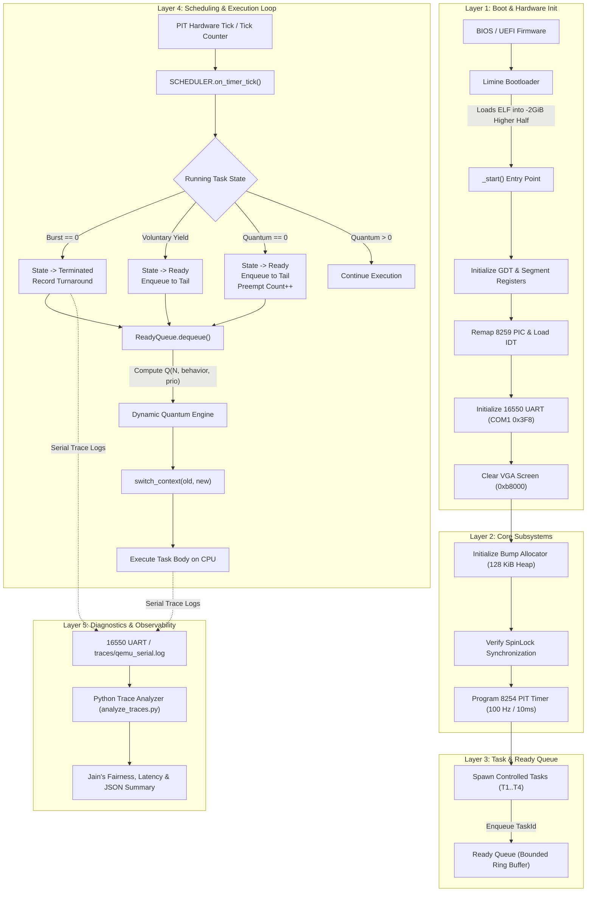

# Yashwanth Micro-OS: System Architecture

## 1. Architectural Overview

**Yashwanth Micro-OS** is an educational bare-metal operating system kernel built in **Rust** for the **x86_64** architecture. It implements core operating system primitives from first principles, specifically focusing on **Scheduler Engineering** with a **Dynamic Quantum Round Robin (DQ-RR)** policy.

The architecture emphasizes modularity, deterministic execution, and transparent observability, adhering to the educational philosophy:

> *OS Concept → Design → Rust Abstraction → Hardware Interaction → Kernel Mechanism → Observable Behaviour*

---

## 2. Layered Architectural Decomposition

```
+-------------------------------------------------------------------------+
|                  Demonstration & Diagnostic Report                      |
+-------------------------------------------------------------------------+
|      Task Management & Dynamic Quantum Round Robin CPU Scheduler        |
|  - Task Control Block (TCB)             - Ready Queue (Ring Buffer)     |
|  - Lifecycle States (Ready, Running...) - Dynamic Quantum Engine        |
+-------------------------------------------------------------------------+
|                   Kernel Synchronization Primitives                     |
|  - SpinLock<T> (AtomicBool)             - RAII SpinLockGuard<'a, T>     |
+-------------------------------------------------------------------------+
|                   Kernel Memory Management Layer                        |
|  - Bump (Linear) Heap Allocator         - Alignment & OOM Guards        |
+-------------------------------------------------------------------------+
|                   Hardware Timers & Interrupt Layer                     |
|  - Intel 8254 PIT (100 Hz Ticks)        - 8259 PIC Vector Remapping     |
|  - Monotonic Tick Counter               - Interrupt Descriptor Table    |
+-------------------------------------------------------------------------+
|                   Kernel Console & Device Drivers                       |
|  - 16550 UART Serial (COM1 0x3F8)       - Standard IBM VGA (0xb8000)    |
|  - Port I/O (inb / outb)                - Structured Diagnostic Logger  |
+-------------------------------------------------------------------------+
|                      Bootloader Handover Layer                          |
|  - Limine Bootloader Protocol (v6/v7)   - Higher-Half Direct Map (HHDM) |
|  - 64-bit Long Mode Paging              - Global Descriptor Table (GDT) |
+-------------------------------------------------------------------------+
|                        Underlying Hardware                              |
|           QEMU Virtualized x86_64 CPU / Bare-Metal Physical PC          |
+-------------------------------------------------------------------------+
```

---

## 3. Data & Control Flow Diagram



---

## 4. Subsystem Responsibilities

### 4.1 Limine Boot & GDT/IDT
- **Entry Point**: `_start` is declared in `src/main.rs` as `extern "C"` with `#![no_mangle]`.
- **Limine Handover**: The bootloader maps the kernel code into the higher-half memory space at `0xffffffff80000000`, establishes a flat 64-bit address space, and passes control to `_start`.
- **GDT Setup**: Reloads 64-bit kernel code segment (selector `0x08`) and data segments (selector `0x10`).
- **IDT & PIC Remapping**: Relocates master PIC vectors to `0x20` and slave PIC vectors to `0x28` to avoid collision with standard x86 exceptions (0x00 to 0x1F).

### 4.2 Serial Console & Diagnostics
- **Driver**: Configures COM1 (port `0x3F8`) at 38400 baud, 8 data bits, no parity, 1 stop bit (8N1).
- **Format Macros**: Implements `log_info!`, `log_warn!`, `log_error!`, `log_sched!`, `log_task!`, `log_sync!`, and `log_mem!`.
- **Output Channel**: Redirected directly to QEMU's `stdio` and captured into `traces/qemu_serial.log`.

### 4.3 Task Abstraction & Context Switching
- **TCB**: Stores `TaskId`, `TaskState` (`Ready`, `Running`, `Blocked`, `Terminated`), execution priority (1..10), total runtime, burst remaining, waiting time, and turnaround time.
- **Context Switch**: `switch_context` preserves callee-saved registers (`rsp`, `rbp`, `rbx`, `r12`..`r15`, `rflags`, `rip`) on task boundaries.

### 4.4 Round Robin & Dynamic Quantum Engine
- **Ready Queue**: A deterministic $O(1)$ ring buffer with capacity `MAX_TASKS = 16`.
- **Dynamic Quantum Recalculation**: Adjusts the time quantum on every context switch based on queue depth $N$, priority factor, and voluntary yield history.

### 4.5 Synchronization & Memory
- **SpinLock<T>**: Atomic mutual exclusion primitive with interrupt masking and RAII guard unlocking.
- **BumpAllocator**: Fast $O(1)$ contiguous linear allocation with alignment enforcement and out-of-memory boundary checks.
